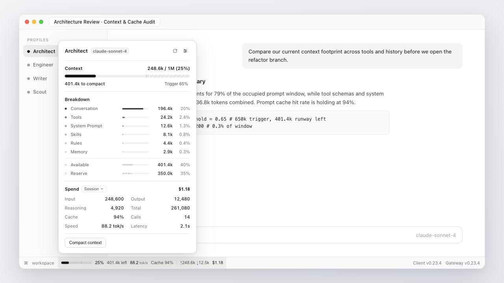
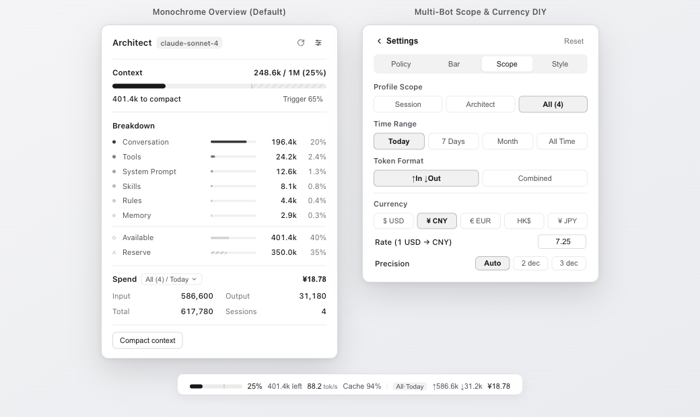
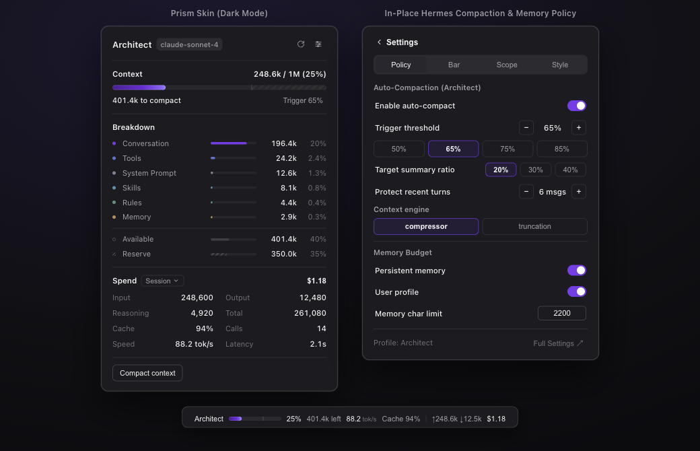

# Context Bar for Hermes Desktop

> Always-on context runway, Claude Code `/context`-style breakdown, multi-bot spend tracking, one-click manual compaction, and read-only policy overview — built natively for the Hermes Desktop status bar.

English | [简体中文](./README.zh-CN.md)



---

## Why This Exists

If you use Hermes Desktop daily across long sessions and multiple bot profiles, four small frustrations add up fast:

1. **You fly blind until compaction hits.** You can't see how close a conversation is to Hermes's auto-compression threshold, or *what* actually filled the window — chat history, tool definitions, system prompts, subagents, rules, or long-term memory.
2. **"Spend" is ambiguous.** A raw dollar figure without scope doesn't tell you whether you're looking at one session, one bot, or all your profiles combined — or whether that's today's cost or this month's, in USD or your local currency.
3. **Context settings live far away from context usage.** Checking how full your window is happens in the chat, while inspecting active `compression.threshold`, `protect_last_n`, or memory budgets — and jumping to Settings when you want to tune them — usually means leaving your conversation flow.
4. **Heavy dashboards break flow.** Full-page analytics tabs are great for weekly audits, not for glancing at your runway mid-conversation. And third-party widgets often clash visually with Hermes's quiet monochrome chrome.

**Context Bar** puts the entire context & cost loop in one calm, native status-bar chip — zero app patches, zero extra LLM tokens, zero external network requests.

---

## What It Does

### 1. Live Context Runway & Breakdown (Claude Code `/context`-Style)
Hover or click the bottom-left status bar to see the live state of whichever bot and session you're viewing:
- **Context bar with compaction marker**: visual fill against your model's full context window, with the exact auto-compression threshold and reserve zone marked.
- **Distance to auto-compaction**: exact remaining tokens before Hermes triggers compression (`e.g. 418.8k to compact · Trigger 50%`).
- **Category breakdown**: sorted breakdown of `Conversation`, `Tools`, `Skills`, `System Prompt`, `Subagents`, `Rules`, `Memory`, `MCP`, plus `Available` and `Reserve`.
- **One-click manual compression**: two-step confirm trigger calling Hermes's native `session.compress` when you want to trim early.

### 2. Read-Only Context & Memory Policy Overview + Quick Settings Jump
Right inside the **Policy** tab (or by clicking the threshold link on the main card), inspect the active bot profile's context and memory policy read-only via the official Desktop Plugin SDK (`config.get`), with a one-click jump to Hermes Settings whenever you want to edit:
- **Auto-compression overview**: inspect active state (`compression.enabled`), trigger threshold (`compression.threshold`), target summary ratio (`compression.target_ratio`), protected recent turns (`compression.protect_last_n`), and `context.engine` (with clear fallback markers when defaults apply).
- **Memory budget overview**: inspect persistent memory (`memory.memory_enabled`), profile memory state, and character limits (`memory.memory_char_limit` / `memory.user_char_limit`) that govern memory budget within the window.
- **One-click Open Settings**: Policy stays strictly read-only inside the plugin; click **Open Settings ↗** to jump directly to Hermes Desktop's official Settings page to modify configuration safely.

### 3. DIY Status Bar & Multi-Scope Consumption
Right-click the status bar (or click the sliders icon) to configure every detail with live preview — persisted locally via `ctx.storage`:
- **Modular status bar**: choose a quick preset (`Minimal` / `Balanced` / `Full`) or toggle 9 items individually — context bar, context %, compaction runway, live generation speed (`tok/s`), token count, cache hit rate, spend, bot name, and model badge.
- **Live generation speed (`tok/s`) & latency**: streams real-time `tok/s` while a reply is generating (`message.delta` / `reasoning.delta`) and snaps to the exact gateway-reported `tokens_per_s` & latency once the turn settles.
- **Explicit spend scope**: switch freely between **Session**, **Current Bot**, and **All Bots** across **Today / 7 Days / Month / All Time** — with clear scope tags in the status bar so you never misread a daily total as a single-chat cost.
- **Multi-currency conversion**: view costs in `USD ($)`, `CNY (¥)`, `EUR (€)`, `HKD (HK$)`, or `JPY (¥)` with customizable local exchange rates and decimal precision.

### 4. Hermes-Native Monochrome by Default, Optional Prism Skin & Bilingual UI
- **Monochrome (Default)**: crisp black/white/grey hierarchy that adapts seamlessly to Hermes Desktop light and dark modes, surfacing color only when context nears or crosses your compaction threshold.
- **Prism Shimmer (Optional Skin)**: switch to a restrained single-tone amethyst bar with optional silk sheen and mineral category accents whenever you want a touch of color.
- **Bilingual (`English` / `中文`)**: auto-detects Hermes Desktop / system language, with one-click manual override under **Style → Language**.

| Monochrome Default | Prism Skin & Policy Panel |
|---|---|
|  |  |

---

## Privacy & Architecture

- **Dual-engine ledger (`dashboard/plugin_api.py` + `desktop/plugin.js`)**: when enabled on a Hermes gateway, a lightweight read-only SQLite endpoint (`/api/plugins/hermes-context-bar/ledger`) aggregates every profile's full session history (including hidden `Bot Chat`, subagents, cron jobs, kanban/group chats, and auxiliary vision/compression/review calls) for exact alignment with cloud billing; in standalone desktop-only mode it falls back automatically to pure SDK queries. Injects zero agent tools/hooks and consumes **0 extra LLM tokens**.
- **Official API pricing & subscription awareness**: aligns fallback rates with official Google Cloud / AI Studio, Anthropic, and OpenAI schedules (including tiered `>200k` prompt pricing), while recognizing subscription/local routes (`openai-codex`, local loopback proxies, Ollama/vLLM) as `$0.00` marginal cash spend.
- **Zero external network requests & pure SDK compliance**: all desktop data flows strictly through the official `@hermes/plugin-sdk` (`ctx.rest`, `host.state`, `host.request`, `host.requestProfile`, `ctx.storage`) — no raw Electron bridge calls. Currency conversion runs strictly offline using your local rate table.
- **Zero credential access**: never reads `.env`, API keys, or OAuth tokens.
- **Zero core patches**: loads cleanly through Hermes's native plugin directories and survives app upgrades untouched.

---

## Installation

### Option 1: Hermes Marketplace / CLI *(once listed in the official catalog)*
```bash
hermes plugins install hermes-context-bar
```
Or search for **Context Bar** inside **Hermes Desktop → Settings → Plugins**.

### Option 2: Direct Install from GitHub
```bash
hermes plugins install https://github.com/tone-leh/hermes-context-bar
```

### Option 3: Manual Local Install (Works Today, Including Pure-Remote Mode)
```bash
mkdir -p ~/.hermes/desktop-plugins/hermes-context-bar
curl -fsSL https://raw.githubusercontent.com/tone-leh/hermes-context-bar/main/desktop/plugin.js \
  -o ~/.hermes/desktop-plugins/hermes-context-bar/plugin.js
```
Press `⌘ + R` (macOS) or `Ctrl + R` (Windows/Linux) in Hermes Desktop to load immediately.

---

## Requirements

- **Hermes Desktop** `v0.21+` (tested on `v0.23.4`, local and remote Tailscale gateways).
- **Local tests** *(zero dependencies, Node 20+)*: `node --import ./test/register.mjs --test test/*.test.mjs`

---

## License

[MIT](./LICENSE)
