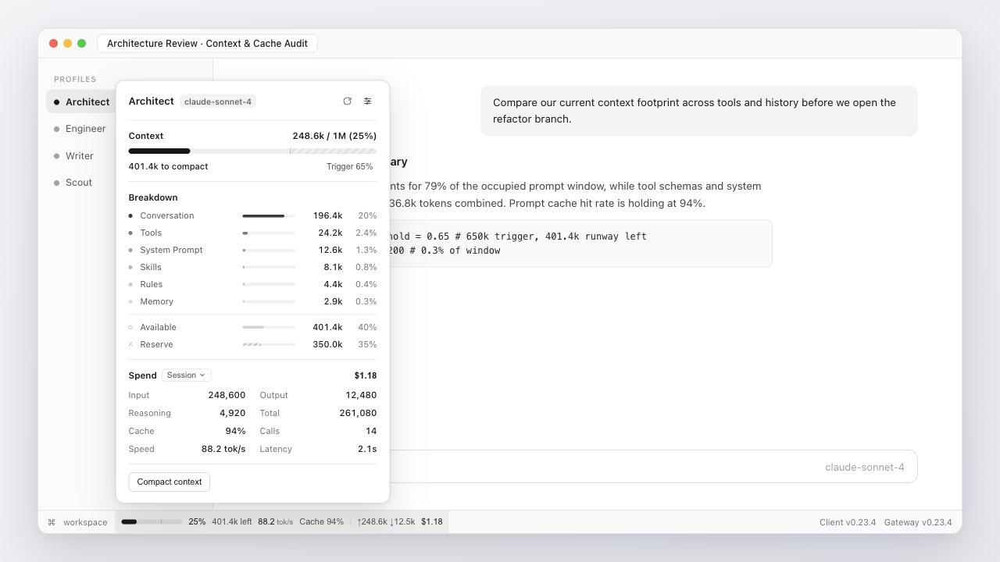
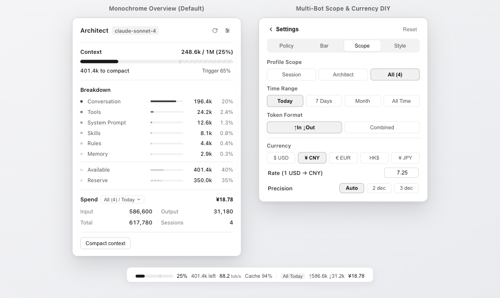
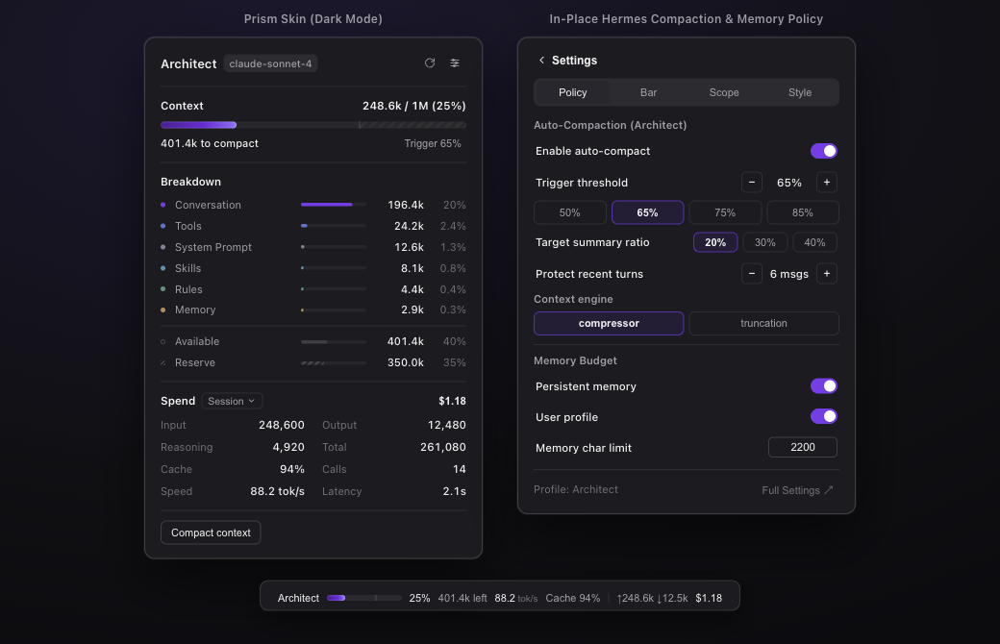

# Context Bar · Hermes Desktop 上下文与用量控制条

> 常驻左下角状态栏的上下文余量条、Claude Code `/context` 风格占用拆解、跨角色/时段费用统计、一键手动压缩与只读策略概览面板（内置中英双语）。

[English](./README.md) | 简体中文



---

## 为什么做这个插件

如果你日常在 Hermes Desktop 里跑长对话、同时养了好几个机器人角色，很快会遇到 4 个具体痛点：

1. **快触发自动压缩了却毫无察觉。** 对话聊到一半突然压缩，或者上下文莫名暴涨，但你根本不知道距离触发线还差多少 Token，也不知道到底是谁吃掉了窗口——对话历史、工具定义、系统提示词、子代理、规则文件，还是长期记忆？
2. **「消耗金额」说不清口径。** 角落里孤零零显示一个 `$2.05`，到底是当前这一条对话的，还是这个机器人今天的，还是全部角色这周的？看美元也不够直观，总要心算人民币。
3. **看上下文的地方，看不到当前生效策略。** 对话中想确认当前角色的自动压缩阈值、保护最近消息数或记忆预算上限，再快速跳去官方设置调整，往往需要在多层页面间来回切换。
4. **重型分析页太重，花哨小组件太吵。** 独立统计页适合周末复盘，不适合对话中随手一瞥；而很多第三方插件色彩过重、侵入感强，破坏了 Hermes Desktop 本身干净的黑白灰界面。

**Context Bar** 把「看余量 → 查构成 → 算花费 → 览策略」收进左下角一枚原生状态栏组件里——不改软件源码、不耗额外 Token、不发任何外网请求。

---

## 核心功能

### 1. 实时上下文余量与 `/context` 风格构成拆解
悬停或点击左下角状态栏，立刻查看当前所聚焦角色与对话的实时状态：
- **带压缩线的上下文进度条**：直观对比已用窗口、自动压缩触发线与预留缓冲区，接近或达到触发线时给出语义提示。
- **精确压缩余量**：直接显示距离下一次自动压缩还剩多少 Token（例如 `距自动压缩 418.8k · 阈值 50%`）。
- **分类占用构成**：按占用排序列出 `对话历史`、`工具定义`、`技能索引`、`系统提示词`、`子代理定义`、`规则文件`、`长期记忆`、`MCP 工具`，以及 `可用余量` 与 `压缩预留`。
- **一键手动压缩**：二次确认防误触，直接调用 Hermes 原生 `session.compress` 主动瘦身。

### 2. 上下文与记忆策略只读概览 + 一键跳转官方设置
点击主览里的「阈值」或右上角设置图标进入 **策略** 页，通过官方 Desktop Plugin SDK（`config.get`）只读查看当前角色的上下文与记忆策略，并提供醒目的官方设置跳转入口：
- **自动压缩策略概览**：只读展示自动压缩开关（`compression.enabled`）、触发阈值（`compression.threshold`）、压缩目标占比（`compression.target_ratio`）、保护最近消息数（`compression.protect_last_n`）及 `context.engine`（未显式配置项自动标注官方默认值）。
- **记忆占用预算概览**：只读展示持久记忆开关（`memory.memory_enabled`）、用户画像开关（`memory.user_profile_enabled`）与字符上限（`memory.memory_char_limit` / `memory.user_char_limit`）。
- **一键打开官方设置页**：策略面板保持干净只读，不直接写入底层配置；点击底部「打开官方设置页 ↗」即可直达 Hermes 官方设置页安全修改。

### 3. 全项可 DIY 的状态栏与清晰消耗口径
右键状态栏或点击滑块图标打开二级配置面板，所有改动实时预览并持久化到原生 `ctx.storage`：
- **状态栏自由拼装**：内置「精简 / 均衡 / 全量」3 套预设，支持 9 项独立开关（进度条、占比 %、距压缩余量、实时生成速度 `tok/s`、消耗 Token、缓存命中率、费用金额、当前角色名、当前模型名）。
- **实时生成速度（`tok/s`）与延迟**：回复流式输出期间按分片实时刷新 `tok/s`（支持正文与思考流），单轮结束后自动对齐网关精确实报的 `tokens_per_s` 与响应延迟。
- **明确角色与时间口径**：消耗统计可在 **当前会话 / 当前角色 / 全部角色** 之间自由切换，跨会话维度支持 **今日 / 近 7 天 / 本月 / 全部**，并在状态栏自动附带口径标签（如 `今日`、`全员·7天`），杜绝误读。
- **多币种本地换算**：支持 `USD ($)`、`CNY (¥)`、`EUR (€)`、`HKD (HK$)`、`JPY (¥)`，支持自定义本地汇率与小数精度。

### 4. 默认极简黑白灰 + 可选棱镜流光 + 中英双语 UI
- **极简黑白灰（默认）**：随 Hermes 浅色 / 深色主题自动适配的黑灰阶层次，日常零视觉打扰，仅在临界警戒时出现语义色。
- **棱镜流光（可选皮肤）**：在 **外观** 页一键切换为深紫单色微光丝带与柔和矿物色点，流光动效可独立开关。
- **中英双语（`自动` / `中文` / `English`）**：默认自动跟随 Hermes Desktop / 系统语言，也可在 **外观 → 界面语言** 一键切换。

| 极简黑白灰（默认） | 棱镜流光皮肤 & 官方策略面板 |
|---|---|
|  |  |

---

## 隐私与工程边界

- **双引擎全量对账架构（`dashboard/plugin_api.py` + `desktop/plugin.js`）**：网关侧启用插件时，通过只读 SQLite 账本接口（`/api/plugins/hermes-context-bar/ledger`）完整汇总全员各角色的隐藏主对话（`Bot Chat`）、子代理、定时任务、看板/群聊及视觉/压缩/后台审阅等辅助调用账单，与云端官方账单严密对齐；单文件桌面模式下自动回退纯 SDK 采集。不向模型注入任何工具或提示词，**0 额外 Token 消耗**。
- **官方阶梯单价与订阅免计费识别**：内置对齐 Google Cloud / AI Studio、Anthropic 与 OpenAI 官方单价及 `>200k` 阶梯费率，同时自动识别订阅套餐与本地推理渠道（`openai-codex`、本地回环代理、Ollama/vLLM）计为 `$0.00` 边际现金消耗。
- **纯官方 SDK 与零外部联网**：所有前端通信均走官方 `@hermes/plugin-sdk`（`ctx.rest`、`host.state`、`host.request`、`host.requestProfile`、`ctx.storage`），支持本地与 Tailscale 远程网关；多币种换算纯离线计算，不请求第三方接口。
- **零凭据读取**：不读取相关密钥文件、API Key 或任何 OAuth 登录态。
- **零源码补丁**：遵循 Hermes 原生插件目录规范加载，软件升级不受影响。

---

## 安装方式

### 方式一：通过 Hermes 官方插件市场 / CLI 安装（上架后）
```bash
hermes plugins install hermes-context-bar
```
或在 **Hermes Desktop → 设置 → 插件** 中搜索 **Context Bar** 一键安装。

### 方式二：直接从 GitHub 仓库安装
```bash
hermes plugins install https://github.com/tone-leh/hermes-context-bar
```

### 方式三：手动本地安装（即刻可用，完美支持纯远程网关模式）
```bash
mkdir -p ~/.hermes/desktop-plugins/hermes-context-bar
curl -fsSL https://raw.githubusercontent.com/tone-leh/hermes-context-bar/main/desktop/plugin.js \
  -o ~/.hermes/desktop-plugins/hermes-context-bar/plugin.js
```
在 Hermes Desktop 中按 `⌘ + R`（macOS）或 `Ctrl + R`（Windows/Linux）刷新即可生效。

---

## 环境要求

- **Hermes Desktop** `v0.21+`（已在 `v0.23.4` 本地与 Tailscale 远程网关下实测通过）。
- **本地单测**（零依赖，Node 20+）：`node --import ./test/register.mjs --test test/*.test.mjs`

---

## 开源协议

[MIT](./LICENSE)
